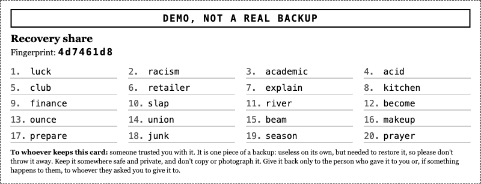
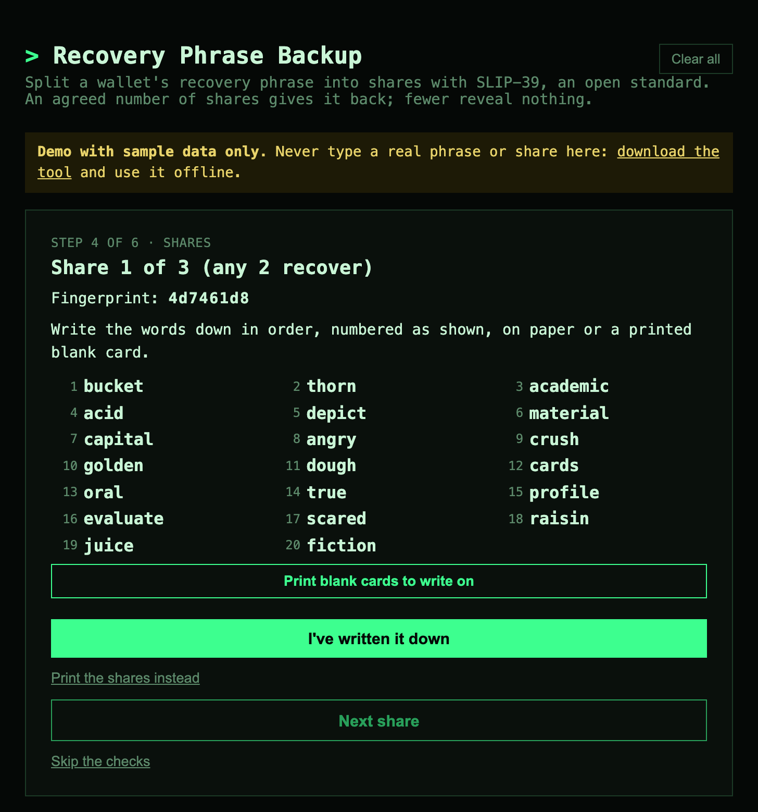

<!-- _class: cover -->
<!-- _paginate: false -->

# Recovery Phrase Backup

Split your seed phrase into shares.

No single place can <strong>lose</strong> it.

No single place can <strong>reveal</strong> it.

---

## One copy fails both ways

Your wallet comes down to 12 or 24 words.

- **Find it** and it's stolen
- **Burn it** and it's gone
- And your family has to be able to recover it if something happens to you

Recovery phrase

<ol>
<li>leopard</li><li>involve</li><li>vital</li><li>powder</li><li>diary</li><li>motion</li>
<li>comfort</li><li>foil</li><li>width</li><li>later</li><li>gasp</li><li>year</li>
</ol>

A backup that a burglar can't use, a fire can't destroy, and your heirs can still recover: getting all three right on your own is hard.

---

## The usual fixes move the risk

| | What's left |
| --- | --- |
| Steel plate | Survives the fire, not the burglar |
| BIP39 passphrase | A second secret that needs its own backup |
| Ledger Recover | Hands parts of your seed to companies |
| Shamir in a wallet (Trezor) | Inconvenient: for an existing seed, a new wallet and moving everything |

---

## Split it into shares

<svg class="story" viewBox="0 0 600 300" role="img" aria-label="A recovery phrase split into three shares, kept in three places: losing one loses nothing, any two recover the phrase, and one alone reveals nothing.">
<text id="c1" class="caption anim" x="300" y="26">Your recovery phrase: one copy.</text>
<text id="c2" class="caption anim" x="300" y="26">Split into three shares, kept in three places.</text>
<text id="c3" class="caption anim" x="300" y="26">One is lost in a fire. Nothing is lost.</text>
<text id="c4" class="caption anim" x="300" y="26">Any two give your phrase back.</text>
<text id="c5" class="caption anim" x="300" y="26">Someone who finds one share learns nothing.</text>
<g id="phrase" class="anim card">
<rect x="250" y="42" width="100" height="66"></rect>
<line x1="262" y1="58" x2="338" y2="58"></line>
<line x1="262" y1="70" x2="330" y2="70"></line>
<line x1="262" y1="82" x2="338" y2="82"></line>
<line x1="262" y1="94" x2="320" y2="94"></line>
</g>
<path id="tick" class="anim tick" d="M 358 70 l 10 10 l 20 -24"></path>
<g id="places" class="anim">
<path class="place" d="M 85 222 l 25 -22 l 25 22 M 92 216 v 30 h 36 v -30 M 104 246 v -14 h 12 v 14"></path>
<path class="place" d="M 278 210 h 44 v 36 h -44 z M 278 210 l 22 -12 l 22 12 M 286 218 v 22 M 300 218 v 22 M 314 218 v 22"></path>
<path class="place" d="M 490 218 m -9 0 a 9 9 0 1 0 18 0 a 9 9 0 1 0 -18 0 M 474 248 q 16 -26 32 0"></path>
<text class="label" x="110" y="272">home</text>
<text class="label" x="300" y="272">bank box</text>
<text class="label" x="490" y="272">a friend</text>
</g>
<g id="share-left" class="anim card">
<rect x="82" y="130" width="56" height="40"></rect>
<line x1="90" y1="142" x2="130" y2="142"></line>
<line x1="90" y1="152" x2="124" y2="152"></line>
<line x1="90" y1="162" x2="130" y2="162"></line>
</g>
<g id="share-mid" class="anim card">
<rect x="272" y="130" width="56" height="40"></rect>
<line x1="280" y1="142" x2="320" y2="142"></line>
<line x1="280" y1="152" x2="314" y2="152"></line>
<line x1="280" y1="162" x2="320" y2="162"></line>
</g>
<g id="share-right" class="anim card">
<rect x="462" y="130" width="56" height="40"></rect>
<line x1="470" y1="142" x2="510" y2="142"></line>
<line x1="470" y1="152" x2="504" y2="152"></line>
<line x1="470" y1="162" x2="510" y2="162"></line>
</g>
<path id="flame" class="anim flame" d="M 110 236 c -22 -8 -18 -34 -4 -48 c 0 12 8 14 10 6 c 4 -10 -2 -18 4 -26 c 12 16 18 30 12 48 c -2 10 -10 18 -22 20 z"></path>
<g id="found" class="anim found">
<g class="card">
<rect x="440" y="120" width="56" height="40"></rect>
<line x1="448" y1="132" x2="488" y2="132"></line>
<line x1="448" y1="142" x2="482" y2="142"></line>
<line x1="448" y1="152" x2="488" y2="152"></line>
</g>
<circle cx="510" cy="160" r="20"></circle>
<path class="handle" d="M 524 174 l 18 18"></path>
<text x="503" y="168">?</text>
</g>
</svg>

Shamir's Secret Sharing, here **2 of 3**. Also 3 of 5, or your own numbers.

---

## Groups: one for you, one for your heirs

<svg class="story" viewBox="0 0 600 300" role="img" aria-label="One backup in two groups: any 2 of 3 places, or any 5 of 7 friends and heirs. Either group alone recovers the phrase; fewer shares reveal nothing.">
<text id="k1" class="caption anim2" x="300" y="26">Group 1: any 2 of 3 places, for you.</text>
<text id="k2" class="caption anim2" x="300" y="26">Group 2: any 5 of 7 friends and heirs.</text>
<text id="k3" class="caption anim2" x="300" y="26">You recover it with 2 of your 3.</text>
<text id="k4" class="caption anim2" x="300" y="26">After you're gone, 5 of the 7 recover it together.</text>
<text id="k5" class="caption anim2" x="300" y="26">Either group alone is enough. Fewer reveal nothing.</text>
<g id="phrase2" class="anim2 card">
<rect x="260" y="44" width="80" height="52"></rect>
<line x1="270" y1="58" x2="330" y2="58"></line>
<line x1="270" y1="68" x2="324" y2="68"></line>
<line x1="270" y1="78" x2="330" y2="78"></line>
<line x1="270" y1="88" x2="316" y2="88"></line>
</g>
<path id="tick2" class="anim2 tick" d="M 350 70 l 8 8 l 16 -20"></path>
<g id="g1" class="anim2">
<text class="glabel" x="135" y="136">group 1: any 2 of 3</text>
<path class="place" transform="translate(-50 0)" d="M 85 222 l 25 -22 l 25 22 M 92 216 v 30 h 36 v -30 M 104 246 v -14 h 12 v 14"></path>
<path class="place" transform="translate(-165 0)" d="M 278 210 h 44 v 36 h -44 z M 278 210 l 22 -12 l 22 12 M 286 218 v 22 M 300 218 v 22 M 314 218 v 22"></path>
<path class="place" transform="translate(-280 0)" d="M 490 218 m -9 0 a 9 9 0 1 0 18 0 a 9 9 0 1 0 -18 0 M 474 248 q 16 -26 32 0"></path>
<text class="label" x="60" y="272">home</text>
<text class="label" x="135" y="272">bank box</text>
<text class="label" x="210" y="272">a friend</text>
<g class="card anim2 join-a" style="--dx: 240px; --dy: -94px"><rect x="40" y="150" width="40" height="28"></rect><line x1="46" y1="160" x2="74" y2="160"></line><line x1="46" y1="168" x2="68" y2="168"></line></g>
<g class="card anim2 join-a" style="--dx: 165px; --dy: -94px"><rect x="115" y="150" width="40" height="28"></rect><line x1="121" y1="160" x2="149" y2="160"></line><line x1="121" y1="168" x2="143" y2="168"></line></g>
<g class="card"><rect x="190" y="150" width="40" height="28"></rect><line x1="196" y1="160" x2="224" y2="160"></line><line x1="196" y1="168" x2="218" y2="168"></line></g>
</g>
<line class="divider" x1="270" y1="122" x2="270" y2="282"></line>
<g id="g2" class="anim2">
<text class="glabel" x="435" y="136">group 2: any 5 of 7</text>
<path class="place" transform="translate(-175 0)" d="M 490 218 m -9 0 a 9 9 0 1 0 18 0 a 9 9 0 1 0 -18 0 M 474 248 q 16 -26 32 0"></path>
<path class="place" transform="translate(-135 0)" d="M 490 218 m -9 0 a 9 9 0 1 0 18 0 a 9 9 0 1 0 -18 0 M 474 248 q 16 -26 32 0"></path>
<path class="place" transform="translate(-95 0)" d="M 490 218 m -9 0 a 9 9 0 1 0 18 0 a 9 9 0 1 0 -18 0 M 474 248 q 16 -26 32 0"></path>
<path class="place" transform="translate(-55 0)" d="M 490 218 m -9 0 a 9 9 0 1 0 18 0 a 9 9 0 1 0 -18 0 M 474 248 q 16 -26 32 0"></path>
<path class="place" transform="translate(-15 0)" d="M 490 218 m -9 0 a 9 9 0 1 0 18 0 a 9 9 0 1 0 -18 0 M 474 248 q 16 -26 32 0"></path>
<path class="place" transform="translate(25 0)" d="M 490 218 m -9 0 a 9 9 0 1 0 18 0 a 9 9 0 1 0 -18 0 M 474 248 q 16 -26 32 0"></path>
<path class="place" transform="translate(65 0)" d="M 490 218 m -9 0 a 9 9 0 1 0 18 0 a 9 9 0 1 0 -18 0 M 474 248 q 16 -26 32 0"></path>
<text class="label" x="435" y="272">friends and heirs</text>
<g class="card anim2 join-b" style="--dx: -15px; --dy: -92px"><rect x="302" y="152" width="26" height="20"></rect><line x1="307" y1="159" x2="323" y2="159"></line><line x1="307" y1="165" x2="319" y2="165"></line></g>
<g class="card anim2 join-b" style="--dx: -55px; --dy: -92px"><rect x="342" y="152" width="26" height="20"></rect><line x1="347" y1="159" x2="363" y2="159"></line><line x1="347" y1="165" x2="359" y2="165"></line></g>
<g class="card"><rect x="382" y="152" width="26" height="20"></rect><line x1="387" y1="159" x2="403" y2="159"></line><line x1="387" y1="165" x2="399" y2="165"></line></g>
<g class="card anim2 join-b" style="--dx: -135px; --dy: -92px"><rect x="422" y="152" width="26" height="20"></rect><line x1="427" y1="159" x2="443" y2="159"></line><line x1="427" y1="165" x2="439" y2="165"></line></g>
<g class="card anim2 join-b" style="--dx: -175px; --dy: -92px"><rect x="462" y="152" width="26" height="20"></rect><line x1="467" y1="159" x2="483" y2="159"></line><line x1="467" y1="165" x2="479" y2="165"></line></g>
<g class="card"><rect x="502" y="152" width="26" height="20"></rect><line x1="507" y1="159" x2="523" y2="159"></line><line x1="507" y1="165" x2="519" y2="165"></line></g>
<g class="card anim2 join-b" style="--dx: -255px; --dy: -92px"><rect x="542" y="152" width="26" height="20"></rect><line x1="547" y1="159" x2="563" y2="159"></line><line x1="547" y1="165" x2="559" y2="165"></line></g>
</g>
</svg>

Any **2 of your 3** places, or any **5 of 7** friends and heirs: either group alone recovers the phrase.

---

## A share card

The fingerprint, 20 words, and a note for whoever keeps it. No address, no share number, no threshold.

---

## Why I built this

Tools for this (SLIP-39) exist. I wanted one that is:

- **Easy**: a wizard from your phrase to checked shares, a recovery test, and a sheet for your heirs
- **Nothing to install**: one HTML file with embedded WebAssembly. Double-click it, offline, on any computer, even a live USB stick
- **Future-proof**: an open standard, not my format. Keep the file next to your shares: browsers still open pages from the 1990s

---

## Two moments: backup and recovery

The backup can ask a lot of you. The recovery can't ask much of your heirs.

**Backup**: once, by you

- You know what a seed phrase is
- A clean computer, offline
- Each copy checked, then a recovery test

**Recovery**: (hopefully) years later

- Maybe not technical, maybe grieving
- A "how to recover" sheet, a note on every card
- One file that still opens, and an open standard

---

## You don't have to trust me

- **Offline**: not a wallet, never touches a network. Ideally on a live USB stick
- **Reproducible build**, signed by **`heeckhau.eth`**: check that the file is built from the published source
- **Open source**, tested against other SLIP-39 tools: you don't even need this one to recover

---

<!-- _paginate: false -->

## Demo

The demo version comes with sample phrases:

heeckhau.github.io/recovery-phrase-backup/demo.html

**Never type your real seed into a computer that's online.**

---

<!-- _class: title -->
<!-- _paginate: false -->

## Try it

**heeckhau.github.io/recovery-phrase-backup**

github.com/heeckhau/recovery-phrase-backup

I'd love your feedback.

What's unclear? What's missing? What would stop you from using it?

